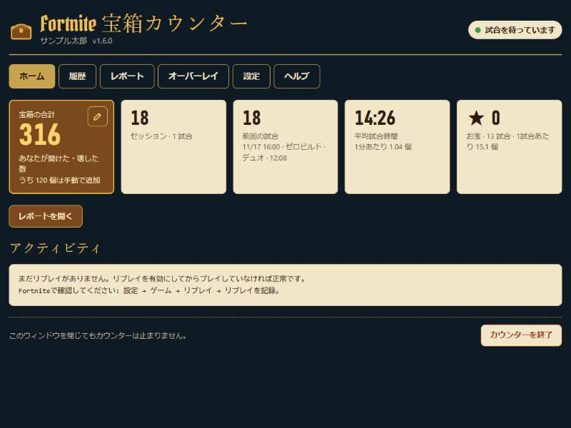
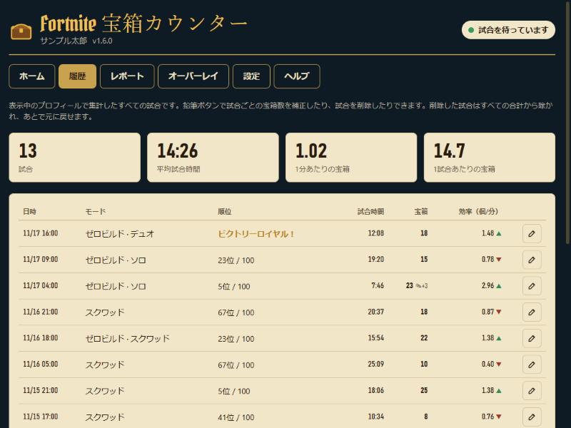
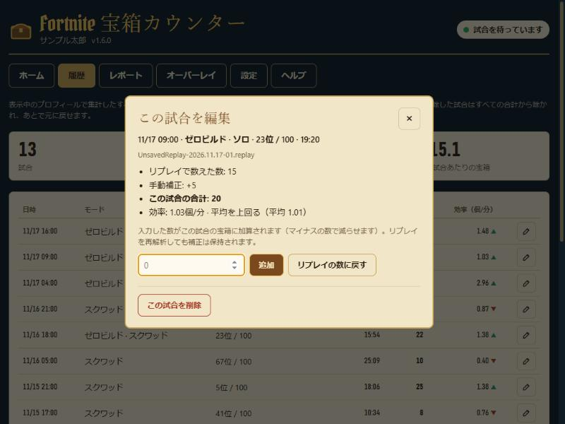

<div align="center">

[English](README.md) · [Français](README.fr.md) · [Español](README.es.md) · **日本語**


# Fortnite 宝箱カウンター（日本語版）

**Fortniteで開けた宝箱を試合ごとに数え、ゲームになじむオーバーレイで表示します。**

[**⬇ ChestCounter.exe をダウンロード**](https://github.com/cherjp/Fortnite-ChestCounter/releases/latest) · Windows 10 / 11 · 無料 · インストール不要

</div>

[LED-N/Fortnite-ChestCounter](https://github.com/LED-N/Fortnite-ChestCounter) 1.5.1 をもとに、次の機能を加えた版です。

- **日本語表示**: ウィンドウ、レポート、オーバーレイ、アクティビティ、CSV まで日本語。日本語の Windows では最初から日本語になります
- **試合時間**: 各試合の時間を、履歴・レポート・ホームの「前回の試合」・CSV に表示
- **平均**: 平均試合時間と 1 分あたりの宝箱数
- **効率**: 試合ごとの 1 分あたりの宝箱数を、同じプロフィールのそれ以前の試合の平均と比べて ▲／▼ で表示
- **履歴タブ**: 試合ごとの宝箱数の補正と、試合の削除・復元

## 仕組み（と安全性）

Fortnite は各試合の **リプレイファイル** を PC に保存できます。宝箱カウンターは試合終了後にこのファイルを読むだけです。

- ✅ `%LOCALAPPDATA%\FortniteGame\Saved\Demos` の `.replay` を読み取り専用で開くだけで、変更はしません
- ✅ ゲームのファイルやメモリには一切触れません
- ✅ ログインもテレメトリもありません。接続先は GitHub だけです（お宝探しのデータ、初回のみのお宝画像、オフにできる新バージョンの確認）
- ✅ ウィンドウの画面は、この PC だけ（`127.0.0.1`、ランダムな鍵付き）に配信されます

> [!IMPORTANT]
> **Fortnite でリプレイを有効にしてください**: *設定 → ゲーム → リプレイ → リプレイを記録: **オン***。リプレイがないと何も数えられません。

Fortnite はリプレイの復号鍵を試合終了時にだけ書き込むため、宝箱は **試合が終わってから数秒後** に集計されます。試合中はオーバーレイの合計の横に **赤い点** が表示されます。

## はじめかた

1. **`ChestCounter.exe`** をダウンロードします（この 1 ファイルだけで動きます）。
2. Fortnite でリプレイを有効にします（上記）。
3. `ChestCounter.exe` を実行します。
   > 「Windows によって PC が保護されました」と表示されたら（署名のない exe のため）: *詳細情報 → 実行*。
4. ウィンドウが開き、PC に残っているリプレイがすぐに集計されます。言語は *設定 → 言語* でいつでも変えられます。
5. プレイ中は開いたままにしてください。最小化しても数え続けます。

> [!TIP]
> *設定 → Fortniteと一緒に起動* をオンにすると、Fortnite の起動に合わせて自動で開き、終了後に閉じます。

## ウィンドウ

タブは **ホーム**、**履歴**、**レポート**、**オーバーレイ**、**設定**、**ヘルプ** の 6 つです。

- **ホーム**: 宝箱の合計、セッション、前回の試合（試合時間付き）、平均試合時間と 1 分あたりの宝箱、お宝、アクティビティ
- **履歴**: すべての試合の一覧と編集（下記）
- **レポート**: すべての統計
- **オーバーレイ**: ゲーム内オーバーレイと OBS 用ページ
- **設定**: 言語、時刻（ローカル／UTC、12／24 時間制）、通知領域、Fortniteと一緒に起動、アップデート、リプレイのフォルダー
- **ヘルプ**: データフォルダー、エラーログ、問題の報告、アンインストール

<p align="center"></p>

### 履歴タブ（試合ごとの編集）

表示中のプロフィールで集計したすべての試合を、新しい順に 25 件ずつ表示します。列は 日時・モード・順位・**試合時間**・宝箱・**効率（個/分）** です。効率の ▲ はそれ以前の試合の平均を上回った試合、▼ は下回った試合です（マウスを重ねると平均の値が出ます）。

<p align="center"></p>

各行の **鉛筆ボタン** で編集画面が開きます。

- **宝箱の補正**: 入力した数がその試合に加算されます（マイナスで減らせます）。0 個未満にはなりません。補正した試合は ✎ 印付きで表示され、**リプレイの数に戻す** で元に戻せます。補正はリプレイを再解析しても保持されます
- **この試合を削除**: 確認のあと、その試合を合計・平均・レポート・CSV から除きます。リプレイを読み直しても再集計されません。履歴タブの下の **削除した試合** から **元に戻す** でいつでも復元できます（補正も保持）

<p align="center"></p>

### カウンターを使う前に開けた宝箱

ホームまたはレポートの「宝箱の合計」の **鉛筆ボタン** から追加できます（入力した数は以前の追加分に足され、× で取り消せます）。数が分からない場合は、Fortnite の *キャリア → 統計* の試合数から見積もれます。

### 別のアカウントから宝箱を移行する

この PC で複数の Fortnite アカウントがリプレイを記録している場合、アカウントごとにプロフィールができます（ウィンドウ上部の名前の横で切り替え）。メインを別のアカウントに移したときなどは、移行先のアカウントを表示した状態で同じ鉛筆ボタンを開き、**別のアカウントから移行** で移行元を選んで **移行** を押してください。

- 移行元の宝箱（リプレイで数えた数 + 手動で追加した数）が、表示中のアカウントの合計に加わります。今週の分は今週の確率にも数えます
- 同じアカウントからもう一度移行すると（**移行し直す**）、前回の移行分を置き換えます。二重には数えません
- 移行元のアカウントの数は変わりません。移行元へ移行したものは移行し返しても数えないので、行き来しても二重になりません
- 手動追加の一覧に「○○ から移行」と表示され、× で取り消せます

## レポート

試合のたびに自動で更新されます: 宝箱の合計、解析した試合、1 試合あたりの宝箱、1 試合の最高記録、**平均試合時間**、**1 分あたりの宝箱**、見つけたお宝、1 日ごとの宝箱、宝箱の種類別、お宝の入手元、あなたの確率（お宝タイム対応）、あなたの試合で入手した人、コレクション、見つけたお宝、最近の試合（**試合時間・効率** の列付き）。同じ内容がデータフォルダーの `report.html` にも書き出されます。

## オーバーレイ

| ショートカット | 動作 |
|---|---|
| **Ctrl+Shift+O** | オーバーレイの表示／非表示（ゲーム中でも有効） |
| **Ctrl+Shift+L** | 固定／固定解除。固定中はマウス操作が透過します |

スタイルは *オーバーレイ → スタイル* で選べます。既定の **カード** は、左に宝箱、右に「宝箱 ───」の見出しと大きな合計、その右に 前回・セッション・お宝 を並べた暗いカードです（試合中は見出しの右に ● 試合中）。ほかに、数字だけの **HUD** と、従来の **クラシック** があります。

カードの宝箱の絵は差し替えられます。好きな PNG（透過 PNG 推奨、正方形に近いもの）を `%APPDATA%\ChestCounter\overlay-chest.png` という名前で置くと、ゲーム内オーバーレイと OBS 用ページの両方がその絵を使います（次の更新時に反映。消すとアプリの宝箱に戻ります）。画像はあなたの PC から外には出ません。

ゲームの上に表示するには、Fortnite を **ウィンドウ フルスクリーン** にしてください。配信用には `%APPDATA%\ChestCounter\overlay.html` を OBS のブラウザソース（ローカルファイル、カードは幅 400 × 高さ 140）に追加します。

## データ

すべて `%APPDATA%\ChestCounter` に保存されます（**ヘルプ → データフォルダーを開く**）。

| ファイル | 内容 |
|---|---|
| `data.json` | 全履歴（試合ごとの補正 `ManualChestsAdded` と、削除した試合 `DeletedMatches` を含む）。PC を変えるときはバックアップしてください |
| `config.json` | 設定 |
| `report.html` | レポート |
| `overlay.html` | OBS 用オーバーレイ |
| `matches.csv` | 1 試合 1 行。日本語では列名も日本語で、末尾に `試合時間_秒;手動補正;1分あたりの宝箱` が付きます |
| `errors.log` | 読み込めなかったリプレイの詳細 |

1.5.1 の `data.json` はそのまま読み込めます（補正 0・削除なしとして扱います）。

## アップデートとお宝探しのデータ

- 新しいバージョンは [cherjp/Fortnite-ChestCounter](https://github.com/cherjp/Fortnite-ChestCounter/releases) のリリースから確認します（*設定 → アップデート* でオフにできます）
- 週ごとの賞品・確率・お宝タイムなどのデータ（`content.json`）とお宝の画像は、元のプロジェクト [LED-N/Fortnite-ChestCounter](https://github.com/LED-N/Fortnite-ChestCounter) から毎回取得するため、毎週の更新がそのまま反映されます

## コマンドラインオプション

```
ChestCounter.exe --lang <fr|en|es|ja>   言語を指定
ChestCounter.exe --demos <フォルダー>    別のリプレイフォルダー
ChestCounter.exe --data <フォルダー>     別のデータフォルダー
ChestCounter.exe --once                 終了済みのリプレイを解析して終了
ChestCounter.exe --reset-config         設定をリセット（履歴は残ります）
```

## 自分でビルドする

[.NET 10 SDK](https://dotnet.microsoft.com/download/dotnet/10.0)（Windows x64）を入れて **`build.bat`** を実行すると `dist\ChestCounter.exe` ができます。回帰テストは次で実行できます。

```
dotnet run --project tests/Regression -c Release
```

## ライセンス

[MIT](LICENSE)。元のプロジェクト: [LED-N/Fortnite-ChestCounter](https://github.com/LED-N/Fortnite-ChestCounter)。リプレイの読み込みは Shiqan 氏の [FortniteReplayDecompressor](https://github.com/Shiqan/FortniteReplayDecompressor)（MIT）をもとにしています。

このプロジェクトは Epic Games とは関係がなく、承認・後援も受けていません。Fortnite は Epic Games, Inc. の商標です。
